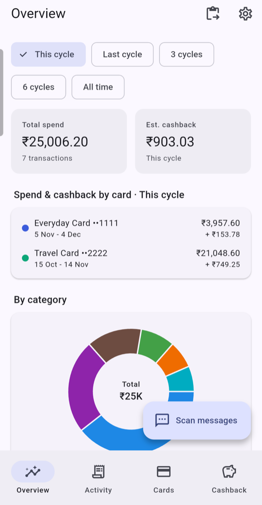
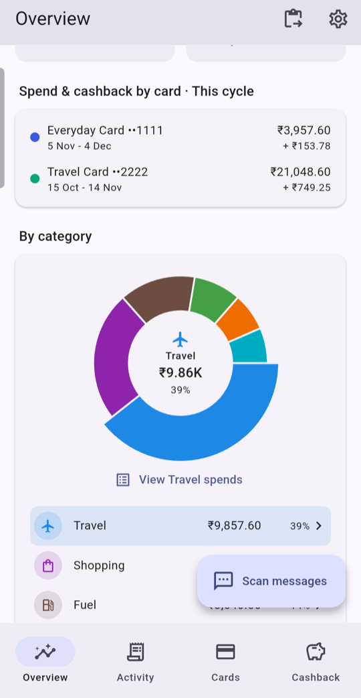
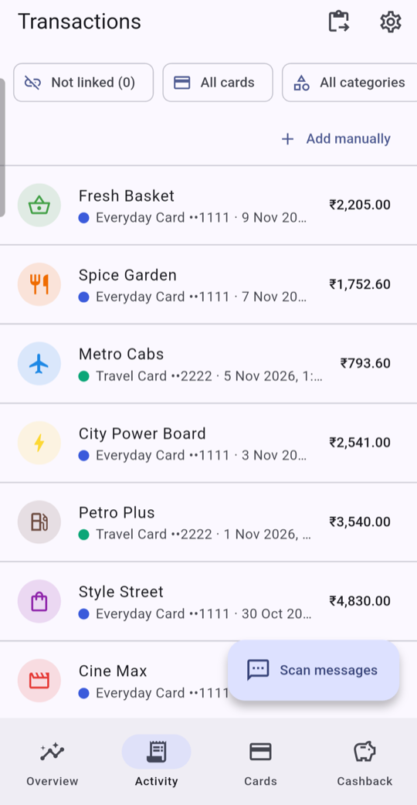
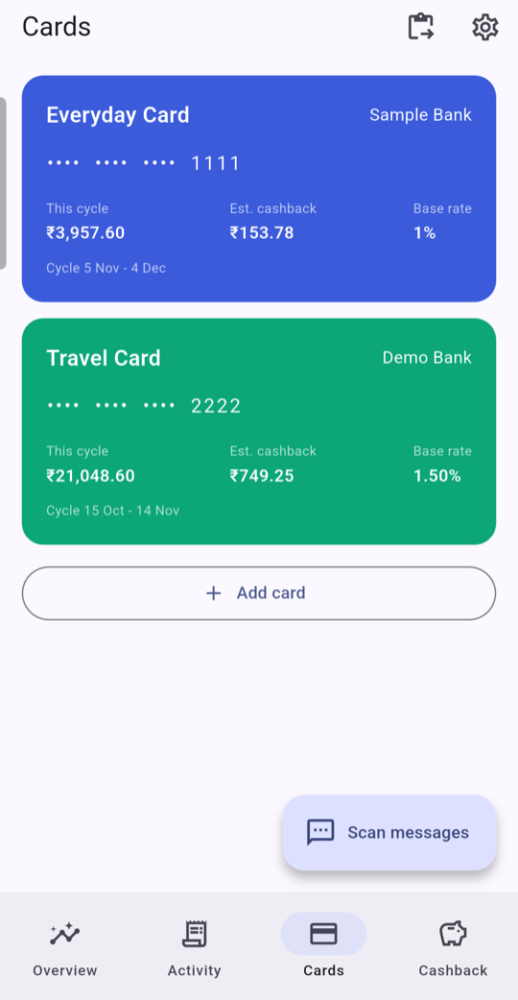
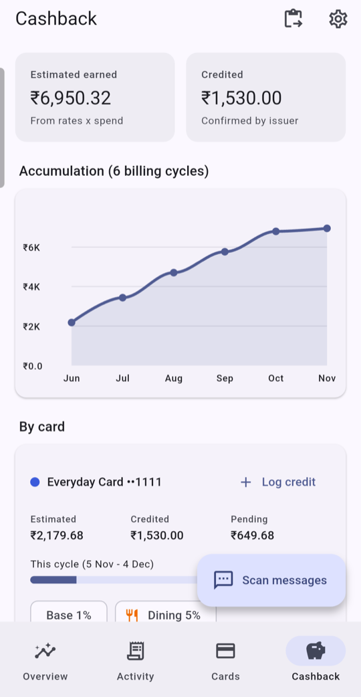

# Cardwise

Flutter app (Android + iOS) that tracks credit card spending and cashback.
Everything stays on your device: there is no account, no server and the app
has no internet permission.

<p>
  
  
  
  
  
</p>

Screenshots use made-up sample data (see `tool/screenshots_main.dart`).

## Download (Android)

Get the latest `cardwise.apk` from the
[Releases page](https://github.com/hnv-7/cardwise/releases/latest), open it on
your phone and allow "Install unknown apps" for your browser or file manager
when asked. Check the SHA-256 listed in the release notes against the file.

The APK is signed with a debug key, not a store key, so Android may show an
"unrecognised developer" warning. iOS builds are not published; build from
source (see Develop).

## Features

- **SMS scanning (Android)**: the **Scan messages** button reads the inbox
  (`READ_SMS`, requested at runtime after an in-app disclosure) and parses
  credit card alerts. Message text is never stored, only amount, merchant,
  category, time and last 4 digits, plus a SHA-256 hash used for de-duplication.
- **Paste import (iOS and Android)**: iOS does not allow apps to read SMS, so
  the paste icon imports copied alerts instead (idempotent).
- **Multi-card management**: add/edit/delete cards with a base cashback rate,
  per-category rates and an optional monthly cap. Transactions link to cards by
  last 4 digits, including cards added after the scan.
- **Spending dashboard**: totals by category (donut), 6-month trend (bars) and
  per-card breakdown, filterable by period.
- **Cashback**: estimated (rate x spend, with monthly cap) vs credited
  (manual log or detected "cashback credited" SMS), per category, per card and
  as a 6-month running total.
- **Categorisation**: keyword rules (`lib/services/categorizer.dart`);
  every transaction can be re-categorised or edited manually.

## Security

- Data is stored as an AES-256-GCM encrypted file; the key is generated with a
  CSPRNG and kept in Android Keystore / iOS Keychain (`flutter_secure_storage`).
- Excluded from Android cloud backup / device transfer (`allowBackup=false`,
  `data_extraction_rules.xml`); no `INTERNET` permission is declared and no
  network code exists.
- Only `READ_SMS` is requested (no send/receive). All amounts are integer minor
  units. Inputs are validated in `AppState`; failed writes roll back state.
- If the vault cannot be decrypted (e.g. after a device restore) the app offers
  retry or erase instead of crashing.

## Google Play note

`READ_SMS` is a restricted permission. Play Console requires a Permissions
Declaration Form and approval before publishing; this app's core purpose
(transaction tracking from SMS) is one of the permitted use cases. Sideloaded /
internal builds work without it.

## Develop

```
flutter pub get
flutter analyze
flutter test
flutter run            # Android device/emulator or iOS simulator
```

Requires JDK 17+ for the Android build (Gradle 9) and Xcode + CocoaPods for iOS.
Before a store release, configure release signing in
`android/app/build.gradle.kts` and an iOS signing team.

## Layout

```
lib/models      data classes (cards, transactions, credits, categories)
lib/services    sms_parser, categorizer, analytics, encrypted vault, sms source
lib/state       AppState (scan, import, validation, persistence)
lib/ui          screens and widgets
android/.../MainActivity.kt   inbox reader (MethodChannel, background thread)
```

## License

MIT, see [LICENSE](LICENSE).
